```sql
SELECT day, contributions FROM activity WHERE day > NOW() - INTERVAL '1 year';
```

<p>
  
</p>

```sql
SELECT name, school, focus
FROM   students
WHERE  github = 'albangerschheimer';
```

| name | school | focus |
| --- | --- | --- |
| Alban Gerschheimer | MIASHS · Paul-Valéry University, Montpellier | Data work (Python, R, SQL), plus some web and Swift on the side |

```sql
SELECT project, what_it_does, built_with
FROM   projects
ORDER  BY rows_crunched DESC;
```

| project | what_it_does | built_with |
| --- | --- | --- |
| [**Maritime Pressures in Europe**](https://github.com/albangerschheimer/Projet-Pression-maritimes-Europe) | 459,773 GBIF occurrences matched against ports and offshore installations, analysed by distance class | SQL · R |
| [**Fake News Detection**](https://github.com/albangerschheimer/fake-news-detection-r) | 44,898 articles classified with TF-IDF | R |
| [**Ligue 1 Match Predictor**](https://github.com/albangerschheimer/Predictions-Foot) | Match outcomes from a home-made Elo rating and form indicators · [live demo](https://pronostic-foot.vercel.app) | Python · scikit-learn · FastAPI |
| [**DeepLearning MIASHS**](https://github.com/albangerschheimer/Project-Deeplearning-S3-Miashs) | Text clustering and image classification, seven models compared | Orange |
| [**Crypto Trading Pipeline**](https://github.com/albangerschheimer/Pipeline-Crypto-Trading) | Collects prices and market data for 50 cryptocurrencies, stores and transforms them, then backtests trading strategies | Python · Binance · CoinGecko |
| [**Lower Back Pain Prediction**](https://github.com/albangerschheimer/Lower-Back-Pain-Prediction) | Normal vs abnormal patients from spine measurements, five classifiers compared | Python · scikit-learn |
| [**Medusa**](https://github.com/albangerschheimer/Medusa) | Public website for jellyfish activity on beaches, design stage in Figma | Figma |
| [**FloatAssist**](https://github.com/albangerschheimer/FloatAssist) | A native macOS floating panel that keeps Claude, Gemini and ChatGPT one keystroke away | Swift · SwiftUI · AppKit |

```sql
SELECT tool FROM toolkit;
```

<p>
  
</p>

```sql
SELECT * FROM github_stats WHERE user = 'albangerschheimer';
```

<p>
  
  
</p>

**Portfolio** → [albangerschheimer.vercel.app](https://albangerschheimer.vercel.app)
